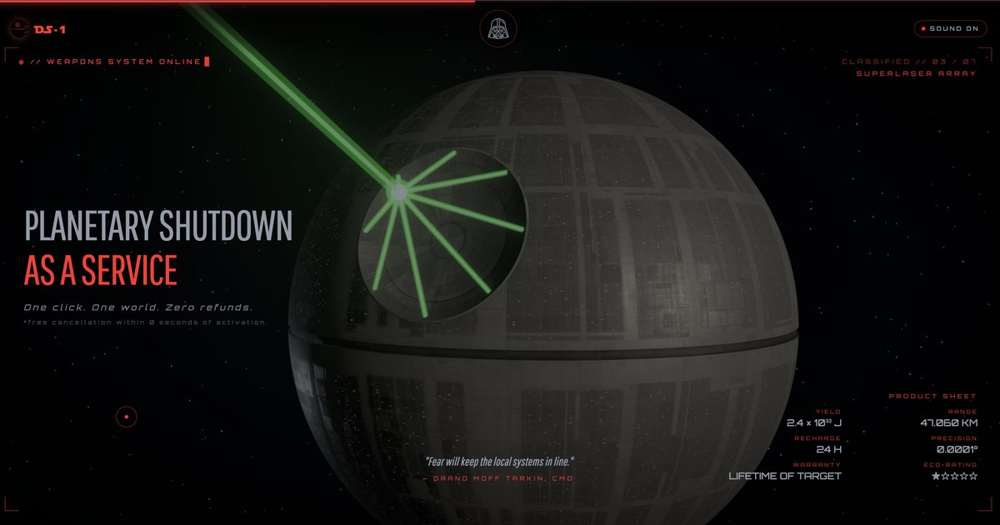

# DS-1 // Death Star — The Ultimate Mobility Experience

> _Planetary shutdown as a service. One click. One world. Zero refunds._

🔗 **Live:** https://www.edoedoedo.it/experiments/death-star-promo/



A scrollytelling experiment shaped like an Imperial product page: opening
crawl, an ironic luxury brochure for the DS-1 Orbital Battle Station, and an
AI advisor ("Master Lucas") grounded on SWAPI.

## Chapters

| # | Chapter | What happens |
|---|---|---|
| 00 | Prologue | Title cards over a 3D Vader helmet, ENGAGE, the yellow crawl over the real starfield (auto-scrolls like in the cinema; any input takes control), then the classic tilt-down that reveals the station. |
| 01 | Arrival | "That's no moon." X-wing chased by a TIE, Falcon, Lambda shuttle, Star Destroyer — with targeting tags — while the station approaches. |
| 02 | Specifications | Technical readout with live counters while the camera orbits the station. |
| 03 | Superlaser | Convergence, fire, the camera swings behind the station and follows the beam to Alderaan: cracks, flash, shockwave ring, debris. |
| 04 | Hyperdrive | Lightspeed jump: stars stretch into streaks (one full-screen shader), flash, boom, tunnel. |
| 05 | Crew | Holographic personnel database; each crew member materialises with a scan line. |
| 06 | Schematics | Yavin-style briefing on a CRT: schematic shader, real pins with leader lines, then a cutaway: exhaust port → shaft → reactor. "Single point of failure." |
| 07 | Acquisition | Lightsaber ignition, "Book your test drive", Master Lucas, credits. |

## Stack

- **Vite + React 18 + TypeScript**
- **@react-three/fiber + drei + postprocessing** — 3D scene, bloom, adaptive DPR
- **GSAP ScrollTrigger + Lenis** — scroll-driven progress for every chapter
- **zustand** — shared progress state
- **Tailwind CSS** — "Sith" theme
- **Web Audio API** — all sounds through gain nodes (volume fades work on iOS too)
- **Groq `openai/gpt-oss-120b`** (+ optional Mistral fallback) via a PHP proxy, **SWAPI** for canon data

## Develop

```bash
npm install
npm run dev            # http://localhost:5173
```

The chat needs the PHP proxy. In a second terminal, from the project root:

```bash
cp api/config.example.php api/config.php   # add GROQ_API_KEY
npm run php                                # = php -S localhost:8000
```

Vite proxies `/api/*` to `localhost:8000`. Without PHP the chat answers with
a local placeholder (dev only); the rest of the site works normally.

```bash
npm run typecheck      # tsc -b (kept out of `build` on purpose)
npm run build          # → dist/
```

## Deploy (Aruba)

1. `npm run build`, then upload the **contents** of `dist/` to
   `www.edoedoedo.it/experiments/death-star-promo/`.
2. Upload `api/groq.php`, `api/.htaccess`, `api/.cache/.htaccess` and
   `api/config.example.php` into `death-star-promo/api/`.
   Keep your existing `api/config.php` (set `GROQ_MODEL` to
   `openai/gpt-oss-120b`; a retired model is replaced automatically anyway).
3. `api/.cache/` must be writable by PHP (rate limit + SWAPI cache). If it
   is not, the proxy falls back to the system temp folder.

## How it works

### Scroll → progress → scene

Each chapter is an empty `SectionDriver` (a tall section) whose ScrollTrigger
maps scroll to a `0..1` value in the store. The 3D components read it in
`useFrame`; the HUDs write it into a CSS custom property (`--p`) and every
element fades with `calc()/clamp()` (`.r-*` classes in `index.css`). No React
re-render per scroll frame.

### Camera

`three/CameraRig.tsx`: monotone cubic interpolation (Fritsch–Carlson) on each
channel, parametrised on the chapter's progress, plus frame-rate independent
damping on position **and** look target. Portrait screens move the camera
back from its target and widen the FOV instead of duplicating keyframes.
Mouse parallax on desktop, hand-held micro motion, impulse shake (`lib/fx`).

### Performance

- One main canvas; the blueprint canvas is mounted in idle time and renders
  only while visible. The main canvas switches to `frameloop="demand"` when
  covered (intro, blueprint, chat).
- Frameloop and DPR are React state passed to `<Canvas>` as props, never
  set imperatively: R3F re-applies Canvas props on every re-render, which
  silently undid `setFrameloop()`/`setDpr()` calls (frozen scene bug).
- Constant light set (no lights inside groups that toggle visibility) +
  `compileAsync`/`initTexture` warm-up (`three/useWarmUp.ts`): no hitches when
  a ship or model appears for the first time.
- Everything is downloaded, mounted and pre-compiled during the intro
  title cards (`lib/assets.ts`); ENGAGE appears when it's all ready. Each
  model has its own Suspense. Crew and helmet GLBs ship without the textures
  the site never used (~2 MB less).
- Optional geometry decimation: `npm run optimize:models` (gltf-transform,
  run it on your machine; originals go to `public/models/_backup/`).
- Device tiers (`lib/device.ts`) + `<PerformanceMonitor>` adaptive DPR.

### Master Lucas

`api/groq.php` receives only `{ history, message }`. System prompt, SWAPI
retrieval (file cache, 24 h), model, token caps and a per-IP rate limit live
on the server. Groq first, Mistral if `MISTRAL_API_KEY` is set.

## Credits

3D models from Sketchfab — non-commercial portfolio use. Full list with
licences in the in-site credits (`src/components/Outro.tsx`).

| Model | Author | Licence |
|---|---|---|
| Death Star | SebastianSosnowski | CC BY-NC-ND 4.0 |
| Millennium Falcon | Yehor.Yanush | CC BY-NC-ND 4.0 |
| Darth Vader Helmet | JJTale | CC BY 4.0 |
| Darth Vader Lightsaber | mrpanini.yt | CC BY 4.0 |
| Stylized X-Wing | Alexander Günther | CC BY 4.0 |
| TIE/ln Fighter | Daniel (Andersson) | CC BY 4.0 |
| Star Destroyer | rubaun | CC BY 4.0 |
| Lambda Imperial Shuttle | tegnemaskin | CC BY 4.0 |
| Storm Trooper | CODAME | CC BY 4.0 |
| K-2SO | Drigui | CC BY 4.0 |
| R5-J2 Astromech Droid | Hunter Wiltse | CC BY 4.0 |
| Mouse Droid (MSE-6) | LarsH. | CC BY 4.0 |
| B1 Battle Droid | tegnemaskin | CC BY 4.0 |
| Holo-Puck | thekaz.2128 | CC BY 4.0 |

Fonts: Star Jedi (self-hosted), Pathway Gothic One, Orbitron, Share Tech Mono,
Inter. Sound clips © Lucasfilm Ltd., demonstration/parody use.

Star Wars, its names, logos and settings are © Lucasfilm Ltd. This project is
a non-commercial, educational/parody experiment.
